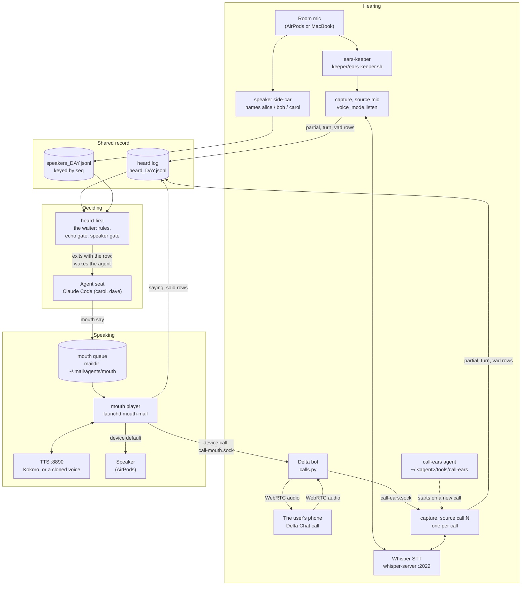
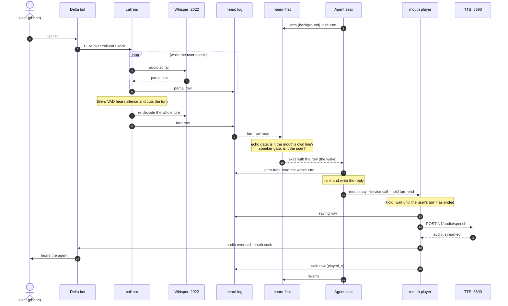
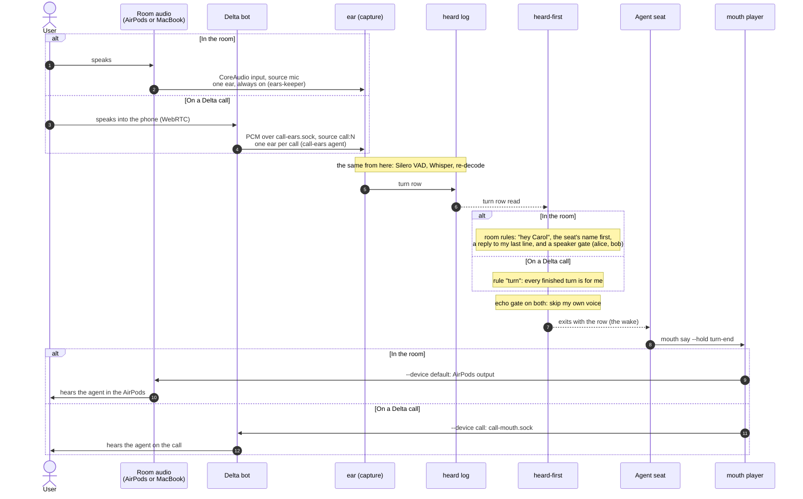

# How the ears and the mouth work

Hearing and speaking are separate processes joined by one log and one
queue. Every ear writes its rows to the heard log; a waiter reads the log
and wakes the agent; the agent queues its reply for the mouth, and the mouth
speaks it and writes its own rows back to the log, so its echo is never
taken for the user speaking.

Two diagrams: a **data flow** (what moves where) and a **sequence**
(one spoken turn on a Delta call, in time order). Drawn on 2030-06-09 from
the processes running on one Mac at that time. Where the code lived then is on the right of each box.
That part is historical: the capture and the mouth have since moved into this
repo (`ears.listen capture` and `mouth mail`), and `ears services install` runs
them as launch agents. The design, the log and the queue are as drawn.

Five diagram types would each answer a different question. This page has
the two that explain the design best:

- **Context** (C4 level 1): the whole system as one box, and the people
  and devices around it. Written for users.
- **Data flow** (this page): audio in, text through, audio out.
- **Sequence** (this page): one turn in time, which shows the delays and
  the echo.
- **State machine**: the waiter and the mouth, armed, in a turn, holding.
- **Component / deployment**: which process, which launch agent, which
  socket.

## 1. Data flow

How to read it:

- **Every ear writes to one log.** The room capture and each call capture
  write the same row format ([events.md](events.md)) into the same file. The
  only difference is `source` (`mic` or `call`) and `device`
  (`airpods`, `call:1169`).
- **The mouth writes to the log too.** Its `saying` and `said` rows are
  how the waiter knows which heard lines are its own echo.
- **The waiter is the only part that wakes an agent.** It is a process
  the agent starts in the background; it tails the log and exits on the
  first row that passes its rules (`turn`, `partial:NAME`, `reply`,
  `cut`). Exiting is the wake.
- **Nothing talks to the agent directly.** Hearing and speaking are
  separate processes joined by a log and a queue, so any agent can use
  them, and one can be restarted without the other.
- **The call ear is started by the call-ears agent.** A new call gets
  its own ear, and that ear exits when the call ends. The bot also keeps
  its own transcriber, which posts each turn to mail.

## 2. Sequence: one turn on a Delta call

### Where the time goes (call 1169, about 9 minutes, 2030-06-09)

From the end of the user's turn to the mouth asking for speech, for three
turns in that call:

- turn row to TTS request: **20 s**.
- turn row to TTS request: **27 s**.
- turn row to TTS request: **96 s**. A long answer; the user spoke again
  70 s after the turn row and the hold waited for that turn to end.

The ear cuts a turn about 1.6 to 1.8 s after the user stops (README,
"Measured"). So **almost all the delay is the agent**: reading the turn,
thinking, and writing the reply. A faster ear cannot fix that; a short
spoken opener ("Mm, good question") queued first, then amended, can.

## 3. Room and call, side by side

How does one turn differ between the room and a Delta call? Only at the
ends. Where they
differ, the diagram splits into two branches, **room** and **call**:

Leg by leg:

- **In.** Room: the input device the keeper picks (AirPods, else the
  MacBook mic), one ear that is always on. Call: the bot decodes the
  call audio to 16 kHz PCM, and the call-ears agent starts an ear for
  each call.
- **Who is it for.** The room has other people in it, so the waiter
  needs my name ("hey Carol") or a reply to my last line, and a speaker
  gate. A call is one to one, so every finished turn is the user's.
- **Speaker names.** The side-car reads the room mic only. On a call a
  line has no name (`speaker_gate: no-name`), which is why the call
  waiter does not use `--speakers`.
- **Echo.** In the room the mic can hear the mouth; on a call the user's
  phone cancels most of it. The waiter's echo gate runs on both, because the
  mouth's `saying` rows are in the same log.
- **Out.** Room: CoreAudio, to the AirPods. Call: `call-mouth.sock`;
  the bot sends what is queued as call audio, paced at 20 ms, and
  silence otherwise.
- **The middle is one path:** the same capture code, log, waiter,
  agent and mouth queue. That is why the call ear was a small change.

## Where each part lived (historical: one Mac, 2030-06-09)

The snapshot the diagrams were drawn from, kept as it was but for one name: the
mouth's launch agent carries the label later measured live, not the one first
written here. Today the capture and the mouth run from this repo; see
[ears.md](ears.md) and [mouth.md](mouth.md).

- Room capture: started by `keeper/ears-keeper.sh`; runs
  `voice_mode.listen capture` from a VoiceMode task worktree of the listen
  spike.
- Call capture: `~/.<agent>/tools/call-ears` (launchd `com.failmode.call-ears`),
  the same capture with code from `~/.<agent>/wt/vm-call-source`.
- Waiter: `heard-first` and `ears-turn` in `~/.local/bin` (branch
  `feat/waiters`).
- Speaker names: `~/.<agent>/speaker-sidecar/speaker-sidecar2.py` (branch
  `feat/speaker-names`).
- Mouth: `voice_mode.mouth` from `~/.<agent>/wt/voicemode-mouth`
  (`feat/mouth-say`), run by a hand-made launch agent, `com.failmode.mouth-mail`.
- Delta bot: `~/.<agent>/delta-chat/bot/` (an earlier bot checkout),
  launchd `com.failmode.<agent>-chat`.
